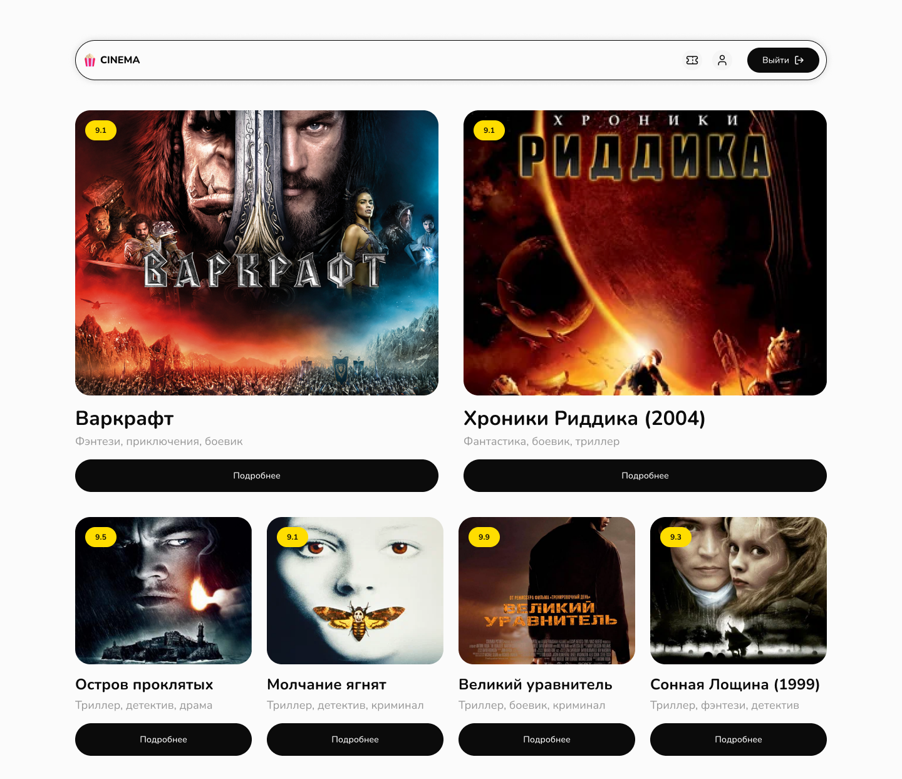

# 🎬 Cinema App

> A cinema application with movie catalog and ticket booking



## 🚀 Tech Stack

- React
- TypeScript
- TanStack Query
- TanStack Router
- TanStack Form
- Zustand
- Mantine
- Vite

## 📦 Getting Started

Clone the repository:

```bash
git clone https://github.com/mynameisedward/cinema-app.git
```

Navigate to the project folder:

```bash
cd cinema-app
```

Install dependencies:

```bash
yarn install
```

Start the development server:

```bash
yarn dev
```

Build for production:

```bash
yarn build
```

Preview the production build:

```bash
yarn preview
`
```
